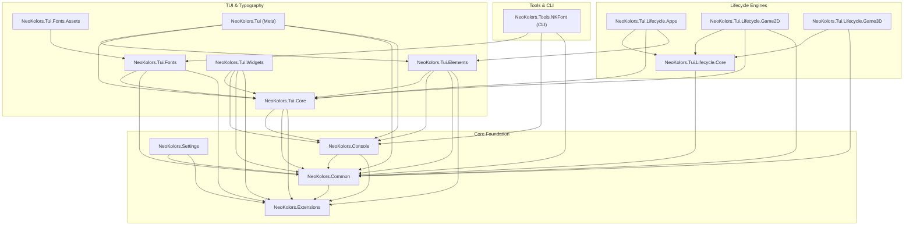

# Solution Project Structure

This document details the architectural project structure, dependencies, and responsibilities across the entire NeoKolors solution.

---

## Dependency Graph

---

## Project Responsibilities

### Foundation Libraries

1. **`NeoKolors.Extensions`**:
   Zero-dependency utility extension library providing high-performance word wrapping (`Chop`), ANSI string visual measuring, 2D array grid utilities (`List2D`), span helpers, and case conversions (`UniversalNamingConvertor`).
2. **`NeoKolors.Common`**:
   Core primitives for console coloring and styling: `NKColor` (32-bit compact RGB TrueColor, 256 colors), `NKStyle` (128-bit explicit layout struct), `NKPalette`, Sixel raster image converter, and `AnsiString`.
3. **`NeoKolors.Console`**:
   Low-level cross-platform terminal driver:
   - Native Linux driver using POSIX `termios` and `epoll` non-blocking asynchronous event loops.
   - Native Windows Console API driver with Virtual Terminal sequence handling.
   - Managed fallback driver.
   - SGR 1006 mouse protocol support.
   - Structured logging (`NKLogger`, binary `.blog` and text outputs).
   - Pretty exception formatting (`ExceptionFormatter`).
4. **`NeoKolors.Settings`**:
   Type-safe configuration engine featuring nested settings nodes (`SettingsNode`), argument validation (`IArgument`), and option merging.

---

### TUI & Typography Libraries

5. **`NeoKolors.Tui.Core`**:
   Double-buffered `NKCharCanvas` and `NKCharScreen`, diff-based ANSI flusher, border styles (`NKBorderStyle`), Z-index layering (`ZLayers`), profiler, and spatial hit-maps (`HitMap`).
6. **`NeoKolors.Tui.Elements`**:
   Component tree: `Flex` (flexbox container), `Grid` (tabular layout), `Table`, `Border`, `Button`, `List`, `Text`, and mouse event routing (`ElementsMouseDispatcher`).
7. **`NeoKolors.Tui.Fonts`**:
   Terminal typography engine: XML V3 font deserializer, MessagePack binary `.nkf` compiler, Figlet font parsing, and dynamic kerning.
8. **`NeoKolors.Tui.Fonts.Assets`**:
   Dedicated embedded asset assembly containing pre-compiled binary fonts (such as `Bytesized` and `Future`).
9. **`NeoKolors.Tui.Widgets`**:
   Standalone interactive widgets (progress bars, spinners, prompts) for standard console streams without full-screen TUI apps.
10. **`NeoKolors.Tui`**:
    Metapackage referencing core, elements, and styling.

---

### Lifecycle Libraries

11. **`NeoKolors.Tui.Lifecycle.Core`**:
    Engine state machine (`ILifecycle`, `LifecycleController`), high-precision frame timing (`FrameClock`), fixed-timestep physics accumulator (`FixedTimestepAccumulator`), and scene stack (`SceneStack`).
12. **`NeoKolors.Tui.Lifecycle.Apps`**:
    Interactive application host (`AppLifecycleHost`), view presenter (`NKAppView`), focus tracking, and execution loop strategies (`ThrottledAppLoopStrategy`, `LazyAppLoopStrategy`).
13. **`NeoKolors.Tui.Lifecycle.Game2D`**:
    Dedicated 2D terminal game loop engine (`Game2DLoop`), 2D camera viewport (`Camera2D`), and multi-stage rendering pipeline (`Render2DPipeline`).
14. **`NeoKolors.Tui.Lifecycle.Game3D`**:
    3D terminal rendering pipeline architecture and viewport management abstractions.

---

### CLI Tools

15. **`NeoKolors.Tools.NKFont`**:
    Global .NET CLI tool (`nkfont`) to create, compile, inspect, and preview custom terminal fonts.
