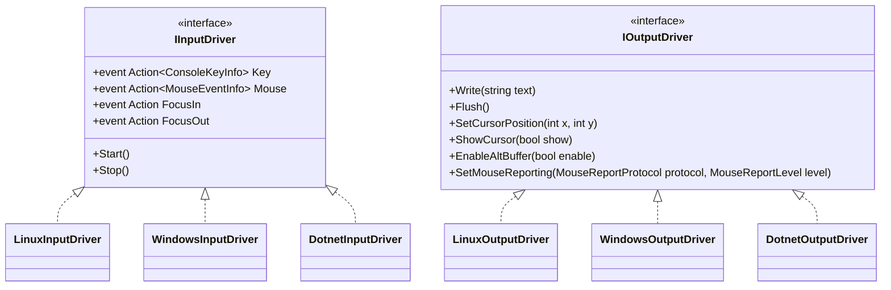

# NeoKolors Console Architecture and Drivers

The `NeoKolors.Console` project is the low-level foundation for the NeoKolors ecosystem. It acts as the driver layer that abstracts terminal inputs/outputs and provides diagnostics, structured logging, and pretty exception formatting.

---

## 1. Driver Architecture

To achieve high-performance, cross-platform terminal control, NeoKolors abstracts input, output, and queries through interfaces:



### 1.1 Input Drivers
* **`IInputDriver`**: Declares events for key presses, mouse clicks/movements, and focus changes.
* **`LinuxInputDriver`**: Native Linux input driver utilizing direct POSIX `termios` configuration, non-blocking asynchronous file descriptor polling via `epoll`, and SGR (1006) mouse protocol parsing.
* **`WindowsInputDriver`**: Native Windows Console API driver leveraging `kernel32.dll` and `ReadConsoleInputW` for low-level input record capturing.
* **`DotnetInputDriver`**: Managed fallback driver that polls `System.Console.ReadKey` and parses incoming ANSI escape sequences.

### 1.2 Output Drivers
* **`IOutputDriver`**: Declares primitives to write to the terminal, move cursors, toggle screen buffers, and configure mouse tracking.
* **`LinuxOutputDriver`**: Native Linux POSIX terminal output driver with optimized unbuffered standard output writing.
* **`WindowsOutputDriver`**: Windows Console API driver enabling Virtual Terminal Processing (`ENABLE_VIRTUAL_TERMINAL_PROCESSING`).
* **`DotnetOutputDriver`**: Managed ANSI output driver using `System.Console.Out`.

---

## 2. Interactive Console Operations (`NKConsole`)

The static class **`NKConsole`** serves as the primary developer-facing entry point. It wraps output operations, buffer toggling, and input hooks.

### 2.1 Virtual Terminal Mode Toggles

```csharp
using NeoKolors.Console;

// Enter Alt Screen Buffer (protects user's shell history)
NKConsole.EnableAltBuffer();

// Disable Alt Screen Buffer upon exit
NKConsole.DisableAltBuffer();

// Hide hardware blinking cursor for smoother TUI rendering
NKConsole.HideCursor();
```

### 2.2 Advanced Input Event Subscription
Instead of polling `Console.ReadKey`, subscribe to clean events:

```csharp
using NeoKolors.Console;
using NeoKolors.Console.Ansi.Mouse;

NKConsole.Key += e => {
    if (e.Down && e.Key == KeyCode.ESCAPE) {
        NKConsole.WriteLine("Exiting application...");
    }
};

NKConsole.Mouse += e => {
    NKConsole.SetCursorPosition(e.Position.X, e.Position.Y);
    NKConsole.Write("X");
};
```
