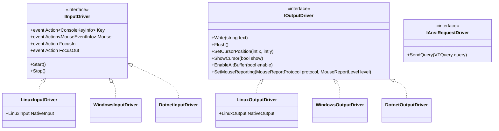

# NeoKolors Console Drivers

The `NeoKolors.Console.Driver` namespace contains the low-level input and output terminal drivers responsible for communicating directly with virtual terminal emulators and platform-specific console APIs.

---

## Architecture Overview

Terminal drivers are split cleanly into three responsibilities:

1. **`IInputDriver`**: Captures raw terminal inputs (keystrokes, mouse events, window focus changes, terminal resize notifications) and decodes them into strongly-typed event objects.
2. **`IOutputDriver`**: Writes formatted string and ANSI escape sequences to the terminal, manages alternate screen buffers, toggles cursor visibility, and sets mouse reporting protocols.
3. **`IAnsiRequestDriver`**: Sends Device Attributes (DA), cursor position queries, or palette queries (OSC) to the terminal and synchronously or asynchronously awaits the terminal's response sequence.



---

## Driver Implementations

### 1. Native Linux Driver (`LinuxInputDriver` & `LinuxOutputDriver`)

Designed specifically for POSIX/Linux systems:
- **Direct P/Invoke / Syscalls**: Uses direct native calls to `termios` (`tcgetattr`, `tcsetattr`), `ioctl` (`TIOCGWINSZ`), and POSIX `epoll` (`epoll_create1`, `epoll_ctl`, `epoll_wait`).
- **Raw Terminal Mode**: Bypasses the standard .NET runtime input buffering, enabling raw input mode with canonical processing and echo disabled.
- **Asynchronous Non-Blocking Input Loop**: Worker thread waits efficiently on the standard input file descriptor (`STDIN_FILENO`) via `epoll_wait`, consuming 0% CPU when no user input is arriving.
- **SGR Mouse Protocol**: Parses SGR 1006 extended mouse tracking sequences (`\x1b[<...M` and `\x1b[<...m`), accurately decomposing button presses, modifier keys, coordinates, and scroll wheel ticks.
- **Terminal Resize Handling**: Intercepts `SIGWINCH` signals to notify the application instantly when the terminal window dimensions change.

---

### 2. Native Windows Driver (`WindowsInputDriver` & `WindowsOutputDriver`)

Designed specifically for Windows environments (Windows Terminal, ConHost, PowerShell):
- **Win32 Console API**: Directly interfaces with `kernel32.dll` via `GetStdHandle`, `GetConsoleMode`, `SetConsoleMode`, and `ReadConsoleInputW`.
- **Virtual Terminal Processing**: Enables `ENABLE_VIRTUAL_TERMINAL_PROCESSING` (0x0004) and `ENABLE_VIRTUAL_TERMINAL_INPUT` (0x0200) for native ANSI sequence support.
- **Low-Level Event Interception**: Decodes raw `INPUT_RECORD` structures containing `KEY_EVENT_RECORD`, `MOUSE_EVENT_RECORD`, `WINDOW_BUFFER_SIZE_RECORD`, and `FOCUS_EVENT_RECORD`.

---

### 3. Managed .NET Fallback Driver (`DotnetInputDriver` & `DotnetOutputDriver`)

A pure managed C# driver providing cross-platform fallback compatibility:
- Uses `System.Console.ReadKey(true)` and parses incoming ANSI escape sequences using `DotnetAnsiParser`.
- Writes directly to standard console streams (`System.Console.Out`).

---

## Automatic Platform Selection

When using `NKConsole`, the optimal driver pair is selected automatically:

```csharp
using NeoKolors.Console;

// NKConsole detects the current operating system:
// - On Linux: Instantiates LinuxInputDriver & LinuxOutputDriver
// - On Windows: Instantiates WindowsInputDriver & WindowsOutputDriver
// - Fallback: Instantiates DotnetInputDriver & DotnetOutputDriver

// Enter Alternate Screen Buffer and hide cursor:
NKConsole.EnableAltBuffer();
NKConsole.HideCursor();

// Subscribe to unified mouse reporting:
NKConsole.Mouse += mouseEvent => {
    NKConsole.WriteLine($"Mouse action at {mouseEvent.Position}: {mouseEvent.EventType}");
};

// Listen to keypresses:
NKConsole.Key += keyInfo => {
    if (keyInfo.Down) {
        NKConsole.WriteLine($"Key pressed: {keyInfo.Key}");
    }
};
```
