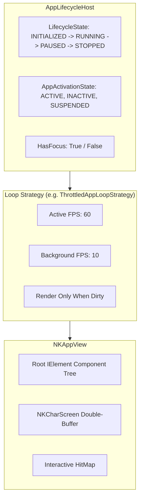

# TUI Application Lifecycle and Hosting

NeoKolors provides a modular, state-driven lifecycle engine designed to decouple application state, window focus, frame rendering, and deterministic updates.

---

## 1. Lifecycle Architecture

The lifecycle architecture is split across two main packages:
- **`NeoKolors.Tui.Lifecycle.Core`**: Foundation abstractions (`ILifecycle`, `LifecycleController`, `FrameClock`, `FixedTimestepAccumulator`, `SceneStack`).
- **`NeoKolors.Tui.Lifecycle.Apps`**: Application hosting infrastructure (`AppLifecycleHost`, `NKAppView`, `ThrottledAppLoopStrategy`, `LazyAppLoopStrategy`).



---

## 2. Application Host (`AppLifecycleHost`)

The `AppLifecycleHost` coordinates application-wide events:

- **Lifecycle States (`LifecycleState`)**:
  - `INITIALIZED`: Host created, preparing to run.
  - `RUNNING`: Main loop running.
  - `PAUSED`: Application suspended.
  - `STOPPED`: Application terminated.
- **Activation States (`AppActivationState`)**:
  - `ACTIVE`: Terminal window is focused and actively receiving user input.
  - `INACTIVE`: Terminal window has lost focus.
  - `SUSPENDED`: Application is temporarily paused.
- **Graceful Shutdown**:
  - Calling `host.RequestClose()` raises the `CloseRequested` event.
  - Event listeners can inspect `CloseCancelEventArgs.Cancel` to abort closure (e.g. prompt for unsaved changes).

```csharp
using NeoKolors.Tui.Lifecycle.Apps;

var host = new AppLifecycleHost();

host.CloseRequested += (sender, e) => {
    if (HasUnsavedWork) {
        e.Cancel = true;
        ShowSavePrompt();
    }
};

host.Start();
```

---

## 3. View Presenter (`NKAppView`)

`NKAppView` coordinates rendering an `IElement` root visual tree onto an `ICharScreen`:
- **Dirty State**: Calling `view.Invalidate()` flags the view as dirty, informing the loop strategy that a frame redraw is required.
- **Hit Testing**: Binds an interactive `HitMap` so child elements can register their spatial bounds during rendering.
- **Lifecycle Hooks**: Emits `BeforeRender`, `Render`, and `AfterRender` events.

```csharp
var view = new NKAppView(rootElement, screen, hitMap);

// Invalidate on state change:
counterSignal.Changed += () => {
    view.RootElement = BuildUi();
    view.Invalidate();
};
```

---

## 4. Execution Loop Strategies (`IAppLoopStrategy`)

### 4.1 Throttled Loop Strategy (`ThrottledAppLoopStrategy`)
Maintains a target framerate (e.g. 60 FPS) when the terminal window has focus, and automatically throttles down (e.g. 10 FPS) when the terminal window loses focus.
- **Wakeup Signal**: Calling `loopStrategy.SignalWakeup()` instantly unblocks the thread from sleeping when mouse clicks, keystrokes, or background tasks complete.

```csharp
var loopStrategy = new ThrottledAppLoopStrategy {
    ActiveFps = 60,
    BackgroundFps = 10,
    RenderOnlyWhenDirty = true
};

while (host.State != LifecycleState.STOPPED) {
    loopStrategy.Tick(host, view);
}
```

### 4.2 Lazy Loop Strategy (`LazyAppLoopStrategy`)
Remains idle until an input event or explicit signal arrives, consuming 0% CPU while idle. Suitable for text viewers and classic CLI utilities.
