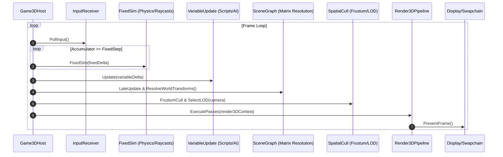

# 3D Game Lifecycle Architecture Plan

This document outlines the architecture, execution pipeline, and component specifications for the **NeoKolors.Tui.Lifecycle.Game3D** subproject when it is implemented.

---

## 1. Architectural Overview

Unlike 2D games, which primarily operate on flat coordinate spaces and layered sprite sorting, a 3D game engine lifecycle must orchestrate:
- **Hierarchical Transform Propagation**: Scene graphs where parent matrix transformations cascade into child local-to-world matrices.
- **Decoupled Simulation Steps**: High-frequency deterministic physics ticks (rigidbodies, joints, colliders, raycasts) alongside variable frame-rate rendering.
- **Spatial Partitioning & Culling**: Hierarchical bounding volume trees (BVH, Octrees) used to perform frustum culling and Level of Detail (LOD) selection before GPU submission.
- **Multi-Pass Graphics Pipeline**: Strict sequencing of shadow mapping, depth pre-passes, opaque geometry, transparent sorting, screen-space post-processing, and HUD composition.
- **GPU Resource Management**: Asynchronous asset streaming, buffer lifecycle (vertex/index buffers, uniform buffers), and render target binding.

---

## 2. Frame Execution Sequence



---

## 3. Multi-Pass Render Pipeline Specification

The 3D pipeline executes through discrete, pluggable render passes:

1. **`ShadowPass`**:
   - Computes directional light Cascaded Shadow Maps (CSM), omnidirectional point light cubemaps, and spot light matrices.
   - Renders shadow caster geometry to shadow map depth buffers.
2. **`DepthPrePass` (Early-Z)**:
   - Renders depth-only for solid geometry to populate the Z-buffer.
   - Eliminates redundant pixel shader invocations on occluded geometry during lighting passes.
3. **`OpaqueGeometryPass`**:
   - Renders solid meshes sorted front-to-back to maximize depth test rejections.
   - Computes material shading (PBR: albedo, roughness, metallic, normal mapping, ambient occlusion).
4. **`TransparentPass`**:
   - Sorts translucent primitives (glass, fluids, particle emitters) back-to-front relative to camera depth.
   - Performs alpha blending with depth write disabled.
5. **`PostProcessingPass`**:
   - Full-screen quad or compute passes applying screen-space effects:
     - Screen Space Ambient Occlusion (SSAO)
     - High Dynamic Range (HDR) Bloom & Tone Mapping (ACES / Reinhard)
     - Temporal Anti-Aliasing (TAA) or FXAA
     - Depth of Field & Motion Blur
     - Color Grading LUTs
6. **`DebugAndGizmoPass`**:
   - Renders debug wireframes, bounding boxes, physics colliders, and light icons.
7. **`HudOverlayPass`**:
   - Projects 2D UI elements, crosshairs, and text over the final composited 3D frame.

---

## 4. Proposed Interface Contracts

```csharp
namespace NeoKolors.Tui.Lifecycle.Game3D;

public interface ISceneGraph3D {
    void AddNode(ISceneNode3D node);
    void RemoveNode(ISceneNode3D node);
    void ResolveWorldTransforms();
}

public interface ISceneNode3D {
    Vector3 LocalPosition { get; set; }
    Quaternion LocalRotation { get; set; }
    Vector3 LocalScale { get; set; }
    Matrix4x4 WorldMatrix { get; }
    bool IsTransformDirty { get; }
    void UpdateHierarchy(ref Matrix4x4 parentMatrix);
}

public interface ICamera3D {
    Vector3 Position { get; set; }
    Vector3 Target { get; set; }
    Matrix4x4 ViewMatrix { get; }
    Matrix4x4 ProjectionMatrix { get; }
    BoundingFrustum Frustum { get; }
    bool IntersectsFrustum(BoundingBox boundingBox);
}

public interface IRender3DPass {
    string Name { get; }
    int Priority { get; }
    bool IsEnabled { get; set; }
    void Execute(Render3DContext context);
}

public interface IRender3DPipeline {
    void RegisterPass(IRender3DPass pass);
    void RemovePass(string passName);
    void Render(Render3DContext context);
}
```

---

## 5. Implementation Roadmap

- **Phase 1**: Core 3D math bridges (Matrix4x4, Quaternions, Frustums, Bounding Volumes).
- **Phase 2**: Scene graph implementation with hierarchical dirty-flag transform caching.
- **Phase 3**: Octree/BVH spatial partitioning structures for frustum culling.
- **Phase 4**: Pluggable `Render3DPipeline` and pass runner.
- **Phase 5**: Integration with renderers (e.g., TUI Sixel/ASCII 3D rasterizer, or GPU backends).
