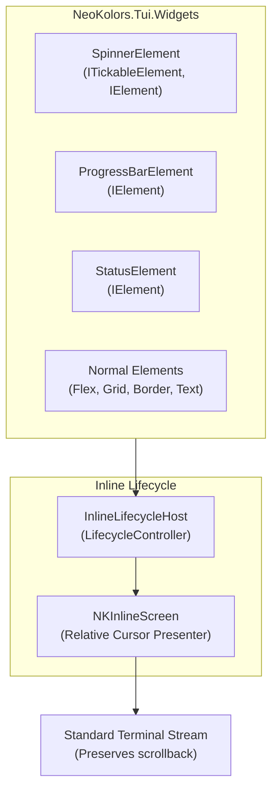

# NeoKolors.Tui.Widgets

[](https://github.com/KryKomDev/NeoKolors/blob/main/LICENSE) [](https://www.nuget.org/packages/NeoKolors.Tui.Widgets) [](https://github.com/KryKomDev/NeoKolors/blob/main/LICENSE)

`NeoKolors.Tui.Widgets` is a companion package providing lightweight, standalone interactive widgets
(such as progress bars, spinners, status monitors, and composite live UIs) directly inside standard
console streams without needing to initialize a full-screen TUI application lifecycle or allocate an
alternate screen buffer.

---

## Key Features

- **Inline Execution Lifecycle (`InlineLifecycleHost`)**:
    - Non-blocking background rendering loop running concurrently alongside your `async` or
      synchronous workloads.
    - Automatically preserves terminal scrollback history and standard output flow.
    - Relative ANSI cursor rewind (`\e[{N}A\r`) and erase-to-end-of-line (`\e[K`), eliminating
      terminal flicker.
    - Option to persist final output (e.g. `✔ Finished in 1.4s`) or cleanly erase the widget area
      upon task conclusion.
- **Composable Elements (`IElement`)**:
    - All widgets implement `IElement`, meaning they can be composed arbitrarily with standard
      NeoKolors elements (`Flex`, `Grid`, `Border`, `Text`, `Table`).
    - Use the exact same widget components in small CLI scripts or nested within full-screen
      `AppLifecycleHost` TUI views.
- **Reactive Updates (`Signal<T>`)**:
    - Update values directly (`progress.Value = 0.85`), automatically reflected in the next render
      frame or via explicit `ctx.Invalidate()`.
- **Rich Presets & Smooth Block Rendering**:
    - Built-in spinner styles: `Dots`, `Line`, `Circle`, `Pulse`, `BouncingBar`, `Arc`, `Braille`,
      `Ascii`, `Clock`, `Arrow`.
    - Progress bar sub-cell smooth filling using unicode fractional block characters (` `, `▏`, `▎`,
      `▍`, `▌`, `▋`, `▊`, `▉`, `█`).

---

## Quickstart Examples

### 1. Simple Status Spinner

```csharp
using NeoKolors.Tui.Widgets.Live;

await NKWidgets.StatusAsync("Fetching dependencies...", async ctx => {
    await Task.Delay(1000);
    ctx.Status = "Compiling bytecode...";
    await Task.Delay(1500);
    ctx.Success("Build succeeded in 2.5s!");
});
```

### 2. Progress Bar

```csharp
using NeoKolors.Tui.Widgets.Live;

await NKWidgets.ProgressAsync("Downloading runtime assets...", async ctx => {
    for (int i = 0; i <= 100; i += 5) {
        ctx.Report(i / 100.0, $"Downloading chunk {i}/100...");
        await Task.Delay(50);
    }
});
```

### 3. Composite UI with Normal Elements

Render any declarative element tree inline in the console stream:

```csharp
using NeoKolors.Common;
using NeoKolors.Tui.Core;
using NeoKolors.Tui.Elements;
using NeoKolors.Tui.Widgets.Elements;
using NeoKolors.Tui.Widgets.Live;

var progress = new Signal<double>(0.0);
var status = new Signal<string>("Starting engine...");

var root = new Border(
    element: new Flex(
        direction: FlexDirection.COLUMN,
        children: new IElement[] {
            new Flex(
                direction: FlexDirection.ROW,
                gap: 1,
                children: new IElement[] {
                    new SpinnerElement(SpinnerStyle.Dots),
                    new Text((Func<AnsiString>)(() => new AnsiString(status.Value)))
                }
            ),
            new ProgressBarElement {
                Value = progress,
                UseSmoothBlocks = true,
                Width = 40
            }
        }
    ),
    style: NKBorderStyle.GetRounded()
);

await NKWidgets.LiveAsync(root, async ctx => {
    for (int i = 0; i <= 100; i += 2) {
        progress.Value = i / 100.0;
        status.Value = $"Processing batch {i}%...";
        await Task.Delay(40);
    }
});
```

---

## Architecture Overview


